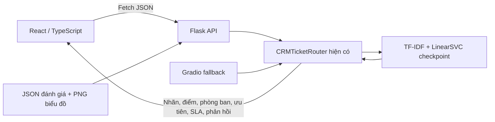

# Ticket Router — React workspace

Giao diện React thay thế cho trải nghiệm sử dụng Gradio, chạy cùng mô hình hiện có. Chưa triển khai lên hosting.

## Kiến trúc

Trước đây, `app.py` tạo Gradio Blocks, nạp `CRMTicketRouter` một lần và gọi `route_ticket_gradio(message, email)`. Hàm này chuẩn hóa khoảng trắng rồi gọi `router.route_ticket`; kết quả được định dạng thành HTML và văn bản phản hồi. Tab Analytics có bảng đánh giá và năm biểu đồ. Project đồng thời đã có Flask server tại `web_app/app.py`, với API JSON và hai giao diện HTML riêng.

React sử dụng lại Flask, không bổ sung FastAPI hay dịch vụ suy luận khác:



API nạp checkpoint một lần khi khởi động. Tiền xử lý TF-IDF, dự đoán, ánh xạ nhãn, softmax decision scores, ngưỡng 60%, từ khóa ưu tiên và SLA đều tiếp tục dùng implementation trong `model/`. Không huấn luyện lại hoặc sửa checkpoint/dataset. API chỉ xác thực kiểu dữ liệu và chuẩn hóa khoảng trắng như giao diện trước.

| Thành phần | Vai trò |
|---|---|
| `src/App.tsx` | Khung ứng dụng, điều hướng bằng URL hash, trạng thái kết nối, hướng dẫn sử dụng |
| `src/pages/RouterPage.tsx` | Form tiếp nhận, năm mẫu Gradio, điều phối dự đoán và lịch sử |
| `src/components/PredictionResult.tsx` | Nhãn, điểm từng lớp, phòng ban, ưu tiên, SLA và phản hồi |
| `src/pages/AnalyticsPage.tsx` | Bốn mô hình, bảng theo lớp, confusion matrix và gallery phóng to |
| `src/services/predictionApi.ts` | Fetch API tập trung, timeout 30 giây, phân biệt lỗi mạng/máy chủ |
| `src/types/prediction.ts` | Kiểu TypeScript theo response thật của Flask |
| `src/hooks/` | Tải dữ liệu có hủy request, chống gửi trùng, lịch sử trong trình duyệt |
| `src/styles/index.css` | Tailwind, design tokens, layout responsive và focus indicators |
| `../app.py` (từ project root: `web_app/app.py`) | Flask API sẵn có, bổ sung health check, validation và CORS |

Giao diện dùng tiếng Việt; các nhóm nhãn và dữ liệu API vẫn giữ tên gốc. Nội dung do người dùng nhập được render dưới dạng văn bản bởi React. Lịch sử lưu tối đa 20 ticket trên thiết bị hiện tại; lỗi localStorage không làm mất kết quả dự đoán đang hiển thị.

## Chạy trên Windows / PowerShell

Yêu cầu Node.js **22.12+ hoặc 24 LTS**, Python environment `pyenv` theo hướng dẫn của project, và checkpoint hiện có trong `model/saved_models/`. Dùng `npm.cmd` để tránh lỗi PowerShell chặn `npm.ps1`; không cần thay execution policy.

Từ thư mục gốc project, cài Python dependencies:

```powershell
& 'D:\InstalledApps\MiniConda\envs\pyenv\python.exe' -m pip install -r requirements.txt
```

Checkpoint được lưu bằng **scikit-learn 1.7.2**; giữ phiên bản này theo `requirements.txt`. Không cần train lại.

Terminal thứ nhất, khởi động backend:

```powershell
.\run_backend_api.bat
```

Lệnh tương đương:

```powershell
$env:HOST = '127.0.0.1'
$env:PORT = '5050'
& 'D:\InstalledApps\MiniConda\envs\pyenv\python.exe' web_app/app.py
```

Terminal thứ hai, cài và khởi động frontend:

```powershell
Set-Location web_app/frontend
npm.cmd install
npm.cmd run dev
```

Hoặc chạy `./run_frontend_dev.bat` từ thư mục gốc; script tự cài npm dependencies nếu chưa có Vite. Mở **http://127.0.0.1:5173**. Chọn mẫu **Chưa nhận hoàn tiền**, nhấn **Phân loại & điều hướng** và xem kết quả thật. Có thể dùng **Ctrl + Enter** hoặc **⌘ + Enter**. API health check ở **http://127.0.0.1:5050/api/health**.

Gradio tiếp tục chạy bằng interpreter có các dependency trong `requirements.txt`:

```powershell
& 'D:\InstalledApps\MiniConda\envs\pyenv\python.exe' app.py
```

Script `run_web_demo.bat` giữ nguyên cấu hình môi trường `tmg_project` của demo Flask cũ. Không dùng script này để khởi động Vite. Nếu port 5050 đã được demo Flask sử dụng, API của demo đó cũng dùng được sau khi khởi động lại với source mới; không chạy hai backend cùng port.

## Cấu hình API

Mặc định React gọi URL tương đối `/api/...` và `/plots/...`. Vite proxy các request này đến backend ở `http://127.0.0.1:5050`. Không có địa chỉ development trong component.

Để đổi backend, sao chép `.env.example` thành `.env.local` trong `web_app/frontend` và chỉnh:

```dotenv
# Trường hợp chạy thông qua Vite proxy:
VITE_API_BASE_URL=
API_PROXY_TARGET=http://127.0.0.1:5050
```

Hoặc cấu hình một API riêng:

```dotenv
VITE_API_BASE_URL=https://your-api.example.com
```

`VITE_API_BASE_URL` chỉ chứa origin, không thêm `/api`. Biến `VITE_` được đưa vào bundle lúc build và công khai cho trình duyệt; không dùng để chứa bí mật. Khởi động lại Vite sau khi sửa env. Khi preview bản build cục bộ, Vite kế thừa proxy từ cấu hình development; hosting tĩnh cần `VITE_API_BASE_URL` hợp lệ hoặc reverse proxy riêng cho `/api` và `/plots`.

Backend đọc biến môi trường của tiến trình; file `web_app/.env.example` là tài liệu mẫu, không được auto-load:

| Biến | Mặc định / ý nghĩa |
|---|---|
| `HOST` | `0.0.0.0` nếu chạy trực tiếp; script mới đặt `127.0.0.1` cho local |
| `PORT` | `5050` |
| `CORS_ORIGINS` | Allowlist gồm localhost/127.0.0.1, port 5173 và 4173; nhiều origin cách nhau bằng dấu phẩy |
| `MODEL_PATH` | Tùy chọn; không đặt sẽ dùng checkpoint hiện có, đường dẫn tính từ module |
| `PYTHON_EXEC` | Dùng bởi script Windows và Playwright để chọn interpreter; mặc định là `pyenv` theo project |

Ví dụ cho frontend hosting riêng:

```powershell
$env:CORS_ORIGINS = 'https://your-frontend.example.com'
.\run_backend_api.bat
```

Không dùng wildcard CORS. Các request JSON và PNG từ origin được cấu hình nhận header CORS; API không yêu cầu cookie hoặc credentials.

| API | Dữ liệu |
|---|---|
| `GET /api/health` | Backend/model readiness; trả HTTP 503 nếu mô hình không nạp được |
| `GET /api/model-info` | Tên mô hình, classes, mapping và metrics của checkpoint |
| `GET /api/samples?source=gradio` | Đúng năm cặp nội dung/email của Gradio Examples |
| `POST /api/route-ticket` | JSON `{ "message": "...", "customer_email": "..." }`; email có thể bỏ qua |
| `GET /api/dashboard-data` | Kết quả bốn mô hình, thống kê dữ liệu và metadata năm biểu đồ |
| `GET /plots/<filename>` | File PNG biểu đồ đã có |

Các endpoint cũ và HTML tại `/`, `/dashboard` của Flask vẫn hoạt động. Kết quả API giữ nguyên cấu trúc `{ success, data }` của project. Body JSON sai, message trống hoặc field không phải chuỗi được trả HTTP 400; mô hình chưa sẵn sàng trả 503.

## Kiểm tra

Từ thư mục gốc:

```powershell
& 'D:\InstalledApps\MiniConda\envs\pyenv\python.exe' -m unittest discover -s web_app/tests -v
```

Từ `web_app/frontend`:

```powershell
npm.cmd run typecheck
npm.cmd run build
npm.cmd run test:e2e
```

Playwright khởi động hai server kiểm thử riêng ở port **5051** và **5174**, rồi dừng các server do nó tạo sau khi chạy xong. Trên Windows nó dùng Microsoft Edge đã cài ở đường dẫn chuẩn. Trên máy khác, cài Chromium cho test nếu chưa có:

```powershell
npx.cmd playwright install chromium
```

Cấu hình `PYTHON_EXEC` nếu interpreter ở vị trí khác. `webServer` dùng lại server sẵn có ở các port test khi chạy local; tắt các server cũ nếu muốn bảo đảm chúng dùng source và env mới nhất. Với CI, biến `CI` làm Playwright luôn tự khởi động server. Mocks chỉ dùng trong test lỗi mạng/máy chủ; các test thành công gọi Flask và checkpoint thật.

Xem [báo cáo kiểm tra](docs/VALIDATION.md) và [bảng đối chiếu chức năng](docs/FEATURE_PARITY.md). Ảnh chụp giao diện thực tế được sinh vào `docs/screenshots/` khi chạy test screenshot.

Danh sách đầy đủ các file được tạo/chỉnh sửa và các cải thiện UI/UX nằm trong [tổng hợp thay đổi](docs/IMPLEMENTATION.md).

## Chuẩn bị deployment

Frontend là SPA tĩnh; điều hướng bằng hash nên không cần rewrite đường dẫn `#router` và `#analytics`. Để chuẩn bị artifact:

```powershell
$env:VITE_API_BASE_URL = 'https://your-api.example.com'
npm.cmd run build
```

Đưa thư mục **`web_app/frontend/dist`** lên Vercel, Netlify hoặc Cloudflare Pages bằng quy trình triển khai của bạn. Build command `npm run build`; output `dist`; root directory `web_app/frontend`. Nếu đổi địa chỉ API, cần build lại. Frontend HTTPS phải gọi backend HTTPS.

Backend chạy độc lập trên Python hosting, với `web_app.app:app` là WSGI application. Trên Linux có thể cài Gunicorn và chạy:

```bash
python -m pip install -r requirements.txt gunicorn
gunicorn web_app.app:app --bind 0.0.0.0:5050 --workers 1
```

Thay port theo yêu cầu hosting và cấu hình `CORS_ORIGINS` bằng origin frontend thật. Đóng gói `model/router_inference.py`, `model/config.py`, checkpoint, `model/results/test_evaluation_summary.json`, `model/plots/`, code Flask và các thư mục `web_app/templates`, `web_app/static` nếu muốn tiếp tục phục vụ demo cũ. Không cần đưa datasets hoặc chạy script training khi khởi động.

LinearSVC và TF-IDF chạy trên CPU, không cần GPU. Artifact checkpoint hiện tại khoảng **0,71 MiB**; kích thước này không phản ánh RAM của Python/scikit-learn. Mỗi WSGI worker nạp một bản mô hình; RAM và concurrency cần benchmark trên hosting đích. Flask development server và Vite dev server chỉ dùng local. `Procfile` hiện có tiếp tục chạy demo Flask cũ và được giữ nguyên; nó chưa phục vụ frontend React.

Chưa có thao tác đăng ký hosting, publish hoặc deploy tự động trong lần thay đổi này.

## Nguồn tham khảo triển khai

- [Vite: hướng dẫn cài đặt và yêu cầu Node](https://vite.dev/guide/)
- [Tailwind: tích hợp Vite plugin](https://tailwindcss.com/docs/installation/using-vite)
